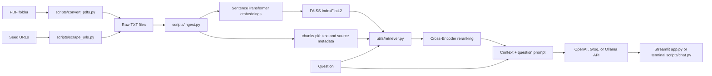

# ChatVeritas: Project Explanation

## 1. What this project does

ChatVeritas is a Python conversational application with two modes:

- **Document-grounded chat (RAG):** searches a selected document collection, reranks the best passages, and sends them with the question to a language-model endpoint.
- **General chat:** sends the question directly to a language-model endpoint without searching documents.

It has a Streamlit web interface and a terminal chat client. The project also provides scripts to collect web text, convert PDFs to text, build document indexes, and inspect saved chunks.

The language model is not bundled or run by the project. ChatVeritas calls OpenAI's API, Groq's OpenAI-compatible API, or an OpenAI-compatible Ollama server using the `openai` Python client. Embedding and reranking models run locally through Sentence Transformers.

## 2. Main technologies

| Technology | Role |
| --- | --- |
| Python | Application, ingestion scripts, and utility modules |
| Streamlit | Browser-based chat interface, uploads, session state, and streaming output |
| OpenAI Python SDK | Makes streaming chat-completion requests to compatible endpoints |
| OpenAI API / Groq API / Ollama | Configurable language-model providers |
| Sentence Transformers | Encodes document passages and questions into vectors |
| FAISS (`faiss-cpu`) | Stores vectors and performs nearest-neighbor search using an `IndexFlatL2` index |
| Cross-Encoder | Scores query/passage pairs to reorder initial FAISS results |
| Hugging Face Hub | Downloads embedding and reranker model files when not already cached |
| LangChain text splitters | Splits text for persistent and temporary document indexes |
| pypdf | Extracts text from uploaded or batch-converted PDFs |
| Requests, BeautifulSoup, Trafilatura | Fetches, follows, and extracts readable web-page content |
| NumPy, pickle, JSON | Numeric embeddings, chunk metadata serialization, configuration and cache utilities |

The primary dependency list is `requirements.txt`. `requirements_local.txt` is a pinned environment snapshot for local use. The model endpoint itself (especially Ollama) must be installed and operated separately.

## 3. Repository map

| Path | Purpose |
| --- | --- |
| `app.py` | Streamlit application: provider selection, vector-store selection, uploads, retrieval, streaming, history, metrics, and source/context display |
| `scripts/chat.py` | Terminal chat client with provider and chat-mode selection |
| `scripts/ingest.py` | Converts the configured raw text directory into a named persistent FAISS store |
| `scripts/convert_pdfs.py` | Converts a folder of PDFs to text, and builds temporary in-memory/session retrieval assets for web uploads |
| `scripts/scrape_urls.py` | Crawls seed pages and saves extracted page text as `.txt` files |
| `scripts/print_chunks.py` | Prints chunk IDs, source names, lengths, and contents from the configured base vector-store path |
| `utils/retriever.py` | Encodes questions, performs FAISS candidate search, reranks results, and returns metrics |
| `utils/reranker.py` | Applies the local Cross-Encoder to candidate passages |
| `utils/vectorstores.py` | Validates vector-store names and discovers valid store directories |
| `utils/model_store.py` | Reuses Hugging Face cache files or downloads models to `data/models/` |
| `utils/chat_history.py` | Formats model messages, recognizes chat commands, and records completed Ollama turns |
| `utils/config_loader.py` | Loads `config/config.json` |
| `utils/paragraph_chunker.py` | A standalone token- and paragraph-aware chunking utility; the current ingestion scripts use `RecursiveCharacterTextSplitter` instead |
| `utils/cache.py` | A standalone JSON cache helper; it is not currently called by the active ingestion or chat flows |
| `utils/test_reranker.py` | Standalone model-load timing probe; not part of `tests/` or the automated unit-test command |
| `tests/` | Unit tests for provider/history behavior and local model-store download/reuse behavior |
| `config/config.json` | Provider endpoints, model IDs, retrieval parameters, generation settings, and data paths |
| `.streamlit/config.toml` | Streamlit configuration; disables the file watcher |

The repository contains saved vector stores under `data/vectorstore_assembly_tutorial`, `data/vectorstore_java_8_JDK_Oracle`, and `data/vectorstore_python3.10`. A valid store has both `index.faiss` and `chunks.pkl`. Raw data, `.env`, the virtual environment, and downloaded models are excluded from version control by `.gitignore`.

### Existing README caveat

The current generation path is a streaming API call to OpenAI, Groq, or an OpenAI-compatible Ollama endpoint; the current configuration uses 2,000-character chunks, 100-character overlap, 50 FAISS candidates, and 9 reranked results. Use `app.py`, `scripts/`, `utils/`, and `config/config.json` as the evidence for current behavior.

## 4. Configuration and providers

The checked-in `config/config.json` currently specifies:

- **Groq:** `https://api.groq.com/openai/v1`, model `openai/gpt-oss-120b`, configured temperature `0.2`.
- **OpenAI:** `https://api.openai.com/v1`, model `gpt-4o-mini`, configured temperature `0.3`.
- **Ollama:** `http://localhost:11434/v1`, model `gpt-oss:20b`, configured temperature `0.3`.
- **Embeddings:** `sentence-transformers/all-MiniLM-L6-v2`, configured for CPU.
- **Reranking:** `cross-encoder/ms-marco-MiniLM-L-6-v2`, configured for CPU.
- **Retrieval:** 9 final chunks, 50 FAISS candidates, 2,000-character chunks, and 100-character overlap.
- **Generation:** maximum 4,000 tokens and fallback temperature `0.4`.
- **Paths:** raw documents at `data/raw` and the vector-store base path at `data/vectorstore`.

The web UI offers Groq, Ollama, and OpenAI, defaulting to Groq. Groq reads `GROQ_API_KEY`; OpenAI reads `OPENAI_API_KEY`. The terminal client defaults to Ollama; selecting Groq or OpenAI requires the corresponding key in `.env`. Ollama must be running locally (or its configured URL must be changed). The application uses the endpoint/model values in the config; it does not start the LLM server.

For Ollama, ChatVeritas sends prior plain question-and-answer turns along with the new request. Retrieved document context is not added to that saved history. Groq and OpenAI calls are stateless in this application: earlier turns are not sent. In both interfaces `/clear` clears chat history; the terminal also accepts `/bye` and `/exit` to quit. In the web UI, exit commands display a notice because the browser chat remains open.

## 5. Document preparation and persistent indexing

### Inputs

The persistent ingestion script reads the **top-level** `*.txt` files in the configured `data/raw/` directory. Place or generate text files there before indexing. PDF and web scripts are optional ways to produce this text:

- `python scripts/convert_pdfs.py <folder_path>` extracts text from each PDF in a folder and writes `.txt` files to `data/raw/` by default. Existing output names are not overwritten; a numeric suffix is added.
- `python scripts/scrape_urls.py` crawls its configured seed URLs (or URLs supplied as command-line arguments), follows links breadth-first up to the configured depth, extracts page content with Trafilatura, and saves text under `data/raw/`. Its URL list, depth, timeout, and output folder are defined in the script.

### Build a named vector store

Run:

```bash
python scripts/ingest.py
```

The script validates `data/raw/`, asks for a unique store name, rejects unsafe names and existing stores, and processes each text file. It cleans separator lines and excess blank lines, then splits text according to `retrieval.chunk_size` and `retrieval.chunk_overlap`, preferring paragraph and sentence boundaries. Each stored chunk records a sequential `chunk_id`, its source filename, and the text.

The embedding model encodes the chunks as NumPy vectors, which are converted to `float32`. The script creates a FAISS `IndexFlatL2`, adds one vector per chunk, and writes a new directory alongside the configured base path. For example, a store named `manuals` is saved as:

```text
data/
├── raw/
└── vectorstore_manuals/
    ├── index.faiss
    └── chunks.pkl
```

`index.faiss` contains the searchable vectors. `chunks.pkl` contains the text and its source metadata, in the same order as the vectors. The store is reusable by both chat interfaces. Names may contain letters, numbers, underscores, and hyphens; spaces are normalized to underscores.

## 6. Document-grounded answer workflow

For a saved vector store, the runtime loads the FAISS index and chunk metadata, checks that their item counts match, and loads the same embedding model used for indexing. For each question it:

1. Encodes the question in the document embedding space.
2. Searches the FAISS index for up to the configured 50 candidates (or fewer if the index is smaller).
3. Scores each candidate together with the question using the Cross-Encoder, then keeps the highest-ranked 9 by default.
4. Constructs a prompt containing the retrieved passages, source-grounding instructions, and the question.
5. Sends a streaming chat-completion request to the selected provider.
6. Displays the answer and, in the web UI, retrieval/generation measurements, source names, and the retrieved text and scores.

The UI reports embedding, FAISS retrieval, reranking, and generation timing, prompt-token count when provided by the endpoint, retrieved chunk count, average FAISS distance, and source names. The web UI also provides a copy-response button.

### Temporary uploads

In the web interface, selecting a saved vector store enables optional PDF and TXT uploads. When uploads are present, they replace the selected saved store for the active session. The app extracts text, chunks and embeds it, builds a temporary FAISS index, and caches the temporary retriever in Streamlit session state keyed by a hash of the uploaded filenames and contents. Temporary files are held in a temporary directory and are not written as a persistent named vector store. The uploader is disabled for general chat.

## 7. General chat workflow

Selecting **General chatting** does not load a retriever, embed the request, search FAISS, or attach uploaded documents. The application sends a direct request with general-assistant instructions to the selected endpoint. In the web UI, only generation-related metrics are shown for this mode. General chat can be used even when there are no saved vector stores.

## 8. Model and data storage

On first use, `utils.model_store.ensure_model_available` checks the local Hugging Face cache and otherwise downloads the requested model into `data/models/<repository-id>`. A completion marker indicates a completed project-local download. Later use reuses that local copy. Thus the first model setup generally needs network access; downloaded model files are ignored by Git.

Persistent indexes are created by ingestion under `data/vectorstore_<name>/`. Existing bundled stores can be selected without rebuilding if their model and dependencies are available. The `data/cache` configuration and `CacheManager` helper exist, but the current chat and ingestion paths do not use that JSON cache.

## 9. Run locally

Use Python with the packages from `requirements.txt`; select a PyTorch wheel compatible with the machine if needed. A typical setup and launch is:

```bash
python -m venv .venv
source .venv/bin/activate
python -m pip install -r requirements.txt
streamlit run app.py
```

On Windows, activate the environment with `.venv\Scripts\activate`. Add `GROQ_API_KEY=...` for Groq or `OPENAI_API_KEY=...` for OpenAI to a local `.env` file; do not commit that file. Or start Ollama and make its configured OpenAI-compatible endpoint/model available. To run the terminal client:

```bash
python scripts/chat.py
```

To build a new collection, first place text files in `data/raw/` and run `python scripts/ingest.py`. The embedding and reranker model files are separate from the language-model endpoint and are obtained locally through Hugging Face as needed.

## 10. Tests and checks run for this explanation

Validation was performed in the repository's existing `.venv` without changing source code or installing packages:

| Check | Result |
| --- | --- |
| `.venv/bin/python -m unittest discover -s tests -v` | **Passed: 12 tests** |
| `.venv/bin/python -m compileall -q app.py scripts utils tests` | **Passed**; Python files compiled successfully |
| `.venv/bin/python -m pytest -q` | **Unavailable:** the check was attempted, but `pytest` is not installed in the existing environment (`No module named pytest`). The repository tests were run with Python's built-in `unittest` runner instead. |

An additional standalone file, `utils/test_reranker.py`, imports a Cross-Encoder, loads its configured model, and prints a single load duration. It is a manual diagnostic, not a test discovered by `unittest discover -s tests`; it was not run for this documentation task because it would trigger model initialization/download and would not constitute a retrieval or answer-quality benchmark.

The unit tests cover CLI provider selection and chat-history behavior, general-chat setup without vector stores, command handling, avoiding partial history after a streaming failure, and model download/cache/retry behavior. They mock provider/model-download interactions; they do not exercise live OpenAI or Groq requests, a running Ollama service, a live Streamlit browser session, or end-to-end embedding and retrieval against downloaded models.

## 11. System architecture and component boundaries

The project separates the user interface, language-model endpoint, document retrieval, and preparation utilities. The central data path for RAG is:



General chat takes a shorter path: user question → provider API → streamed answer. It intentionally bypasses the embedding model, vector store, reranker, and document context.

### Runtime responsibilities

- **`app.py`** owns the web interaction: page setup, sidebar selections, provider client construction, resource caching, uploaded-file lifecycle, chat display, streaming and error display. `st.cache_data` caches config; `st.cache_resource` caches loaded retrievers keyed by their arguments. Streamlit session state holds visible messages, active-corpus identity, upload retriever/signature, and Ollama history.
- **`scripts/chat.py`** is the interactive terminal client. It presents general chat as option zero and discovered stores as numbered options, then prompts for Ollama (default), Groq, or OpenAI.
- **`utils.retriever.Retriever`** loads the index and chunk list, checks that the counts match and that the index is non-empty, then performs query encoding, candidate lookup, and reranking. It fails fast for non-positive `top_k` or candidate counts.
- **`utils.reranker.Reranker`** forms `(question, passage)` pairs, predicts scores with the configured Cross-Encoder, sorts descending by score, and returns the requested number.
- **`utils.chat_history`** defines exact, case-insensitive terminal/web chat commands and provider-specific message/history behavior. Completed plain question/answer exchanges are retained only for Ollama.
- **`utils.model_store`** places model artifacts under the project data directory and uses a marker file to avoid re-downloading a completed model.

### Stored index contract

The FAISS vector at position *i* corresponds to chunk metadata at list position *i*. `chunk_id` is also recorded for display and tracing. Each metadata item has `chunk_id`, `source`, and `chunk`. The reader verifies vector count equals metadata count; this protects against obvious index/metadata mismatch but does not validate the pickle's trustworthiness or every metadata field's schema.

## 12. User-facing behavior and state

### Streamlit

1. The user chooses **General chatting** or a discovered saved vector store in the sidebar.
2. For a RAG store, the user may upload multiple PDF or TXT files. A non-empty upload set takes precedence over the saved corpus. It is explicitly session-temporary. General chat disables and discards upload selection.
3. The user selects Groq, Ollama, or OpenAI and submits a question.
4. Streamed answer tokens appear in the assistant message. A copy button is shown for assistant messages.
5. RAG sessions expose retrieval timing, source list, retrieved passages, FAISS distances, Cross-Encoder scores, and generation metrics. General mode exposes generation time and prompt tokens.
6. Changing provider resets Ollama history; changing the active corpus resets visible messages and Ollama history. `/clear` clears history/messages. `/bye` and `/exit` cannot close a browser tab and instead produce a notice.

The UI reports provider/retrieval construction errors and displays a traceback in technical details. A failed generation is displayed as an error rather than as an ordinary completed assistant answer.

### Terminal

The terminal prompts the user to choose a chat mode and endpoint, then accepts messages in a loop. `scripts/chat.py` supports `/clear`, `/bye`, `/exit`, and the additional exact inputs `exit`, `quit`, and `q` for quitting. It catches keyboard interrupt and end-of-input at the input prompt. It prints model/provider startup information and indicates whether Ollama history is enabled.

There is a maintainability issue worth verifying/fixing in a future code change: `scripts/chat.py` returns the response before the later block that prints its RAG metrics and sources. As written, that metrics-reporting block is unreachable. The Streamlit UI does render those metrics. This report records the behavior; it has not been changed as part of this documentation task.

## 13. Retrieval and generation details

### Index construction

`scripts/ingest.py` loads config at module import, resolves the repository root, checks that the raw directory exists, prompts until it receives a valid unused store name, and looks only for top-level `*.txt` files. It cleans repeated blank lines and separator-only lines. The configured splitter is character-based (`length_function=len`) and prefers `"\n\n"`, newline, period-space, space, then arbitrary character boundaries. Current values are a 2,000-character chunk and 100-character overlap.

The embedding call converts every chunk to a NumPy vector; vectors are cast to `float32`. It chooses CUDA for ingestion if `torch.cuda.is_available()` and otherwise CPU. The persistent retriever, by contrast, passes the configured embedding device (currently CPU). This means a store may be built on GPU but queried on CPU; the model identity and vector dimension must still match. FAISS uses `IndexFlatL2`, a flat exhaustive L2 search index, rather than an approximate index.

### Query and reranking

The retriever embeds one query and searches for `min(faiss_candidates, index.ntotal)` results. Candidate records preserve their FAISS rank and distance. The reranker scores the question against each candidate's text, orders candidates by Cross-Encoder score descending, and truncates to `top_k`. The final RAG prompt concatenates selected text passages and includes explicit grounding instructions; context is treated as the primary source and the prompt directs the model to acknowledge insufficient context rather than invent facts.

The configured `top_k=9` therefore refers to final Cross-Encoder-selected results, while `faiss_candidates=50` is the first-stage candidate pool. These parameters can be tuned independently, subject to the number of indexed chunks and endpoint context length.

### Language-model request

Both clients use the OpenAI SDK's Chat Completions interface with `stream=True`, configured model, temperature, and `max_tokens`. The shared history helper sends a system message, optionally prior Ollama plain turns, and the current prompt. The retrieval context is included in the current prompt; it is not copied into the stored conversation history. Stream usage token counts are recorded when a provider includes usage in streamed chunks; absent usage is rendered as zero.

The Groq URL, model, and configured temperature come from `config["llm"]`; OpenAI values come from `config["model_openai"]`, and Ollama values come from `config["model_ollama"]`. In the web app the active provider's temperature overrides the generation fallback. The CLI currently uses `config["generation"]["temperature"]` instead of the active endpoint's configured temperature. This is a behavior difference between clients and a candidate for later alignment.

## 14. Dataset inventory observed in the checkout

The working tree contains three raw corpora and three matching serialized vector stores. Counts below were obtained by reading the local files and unpickling chunk metadata; they describe this checkout, not a general guaranteed release size.

| Corpus/store | Raw `.txt` files | Raw bytes | Chunks | Sources represented | Mean chunk characters | FAISS bytes | Metadata bytes |
| --- | ---: | ---: | ---: | ---: | ---: | ---: | ---: |
| Assembly tutorial | 1 | 58,037 | 33 | 1 | 1,771.9 | 50,733 | 59,183 |
| Java 8 Oracle | 84 | 343,118 | 237 | 84 | 1,458.2 | 364,077 | 356,353 |
| Python 3.10 | 34 | 1,565,186 | 1,048 | 34 | 1,504.9 | 1,609,773 | 1,609,306 |

These are useful descriptive corpus statistics, not an evaluation dataset: the checkout does not include question/answer labels, relevance judgments, a held-out test set, or a retrieval-quality benchmark. The corpus names and contents also do not establish source licensing or a documented data-cleaning/evaluation protocol; a formal report should record provenance and usage rights before publishing corpus-derived examples.

## 15. Validation evidence and timing interpretation

The test results are from this checkout's existing `.venv`, on the machine and at the time the documentation was prepared. Timings are single-run observations, not statistically robust performance benchmarks:

| Validation | Observed result | Timing and interpretation |
| --- | --- | --- |
| `python -m unittest discover -s tests -v` via `.venv/bin/python` | 12 tests passed; no failures/errors | Test runner reported 0.067 s; shell elapsed time was 0.508 s. The difference includes Python process startup and shell timing. |
| `.venv/bin/python -m compileall -q app.py scripts utils tests` | Passed | Shell elapsed time 0.029 s. |
| `.venv/bin/python -m pytest -q` | Not available | Attempted, but `pytest` is absent (`No module named pytest`). The standard-library `unittest` suite ran successfully instead. |
| `git diff --check` and new-document whitespace check | Passed | No whitespace errors reported. |

These timings measure the local test/compile commands only. **No live RAG latency, model-loading latency, throughput, memory, GPU/CPU comparison, or answer-quality metric was measured.** Do not present the unit-test duration as application response time. At runtime, the retriever measures embedding, FAISS search, and reranking durations for each RAG question, and the chat layer measures generation duration. Those values must be collected from representative runs to report product performance.

### Test coverage map

`tests/test_chat_history.py` has twelve tests covering:

- A successful CLI response stores only the completed plain question and answer, not retrieved private context.
- General chat sends a direct request without retrieval.
- CLI OpenAI selection uses `OPENAI_API_KEY` and its configured API URL; missing credentials fail explicitly.
- OpenAI history status and `/clear` messages identify OpenAI as stateless.
- General chat initializes when no saved stores exist.
- A failed stream does not store a partial response.
- `/clear` clears history before the next CLI turn.
- Ollama requests include prior plain turns.
- Groq and OpenAI requests omit prior turns.
- Only successful Ollama exchanges are recorded.
- Chat command parsing is case-insensitive and exact.

`tests/test_model_store.py` has three tests covering:

- A locally cached model is copied to the project store and reused after completion.
- Cache miss falls back to a download.
- A failed download does not leave the completion marker.

The current suite uses mocks for provider streams and Hugging Face downloads. It does not establish endpoint availability, exact prompt behavior for every UI path, correctness/recall of search rankings, PDF extraction fidelity, crawler robustness, upload/session isolation in a running Streamlit server, compatibility with every dependency version, or performance under concurrency.

## 16. Improvements and future work, prioritized

The following items are recommendations inferred from the current implementation; they have not been implemented or measured in this documentation-only change.

### Priority 1: correctness, reproducibility, and report-grade evaluation

1. **Make tests repeatable in supported environments.** Declare and document one canonical test command and test dependency policy; run the same suite in CI on supported Python/platform combinations.
2. **Add deterministic retrieval tests.** Use a tiny known FAISS fixture with expected top candidates and reranked order. Test empty indexes, invalid or corrupt metadata, fewer chunks than requested candidates, and model/index dimension mismatch.
3. **Add end-to-end smoke tests with mocks.** Exercise app and CLI prompt construction, provider selection, upload replacement, corpus switching, and error-state handling without depending on live credentials or internet.
4. **Create an answer-quality evaluation set.** Prepare representative questions, authoritative expected facts/citations, and relevant chunk labels. Report Recall@k, MRR or nDCG for retrieval, groundedness/faithfulness and answer correctness for generation, and explicit abstention quality.
5. **Run and publish a controlled latency benchmark.** Record hardware, OS, Python/dependency/model versions, device, corpus, warm/cold state, prompt length, concurrency, and sample count. Separate model startup/download from steady-state embedding, retrieval, reranking, and provider generation. Report median and tail percentiles (for example p50/p95), not only one elapsed time.
6. **Make configuration consistent between interfaces.** Align the CLI and Streamlit temperature behavior and test both; explicitly document provider-specific conversation semantics.

### Priority 2: reliability and data correctness

1. **Make persistent index creation transactional.** Build index and metadata in a temporary sibling directory, validate both, then publish the completed store atomically. Currently the target directory is created before both output files are safely written, so interruption can leave a directory that blocks a retry while being undiscoverable as a valid store.
2. **Validate corpus/index compatibility.** Store model ID, vector dimension, splitter settings, and a format version with each index; verify them at load time. A matching vector/chunk count alone cannot detect an index made with a different embedding model.
3. **Validate source input quality.** Report empty documents, duplicate files/chunks, encoding problems, and PDFs with no extracted text. Scanned PDFs require OCR, which the present `pypdf` text extraction does not provide.
4. **Harden the crawler.** Restrict crawl scope to intended hosts, normalize URL query strings, set a user agent and request pacing, bound page/byte counts, handle redirects and robots policy as appropriate, and write failures in a machine-readable crawl report.
5. **Improve upload feedback and limits.** Enforce file size/page/chunk limits, report per-file extraction failures, and test mixed valid/invalid uploads. Temporary uploads currently require reading the complete payload into memory.
6. **Improve metadata format safety.** `chunks.pkl` is Python pickle and should only be loaded from trusted stores. Consider a portable JSONL/Parquet/SQLite metadata format, schema validation, and integrity hashes.
7. **Clarify provider history privacy.** Keep tests proving that retrieved context is excluded from retained history and explain provider/network data handling, API retention, and local Ollama configuration in user-facing deployment documentation.

### Priority 3: scalability and operational quality

1. **Measure before changing the FAISS index.** `IndexFlatL2` is exact and simple, appropriate for current small example stores. Benchmark speed and recall as corpus sizes grow before selecting IVF/HNSW or compression.
2. **Batch and cache only with explicit invalidation.** Model loading is costly but cached by Streamlit resources; profile startup and memory first. The standalone `CacheManager` is not wired into the active ingestion flow and should not be described as an active embedding cache.
3. **Tune chunking and retrieval using labeled data.** Compare character-based chunk sizes/overlaps, semantic or token-aware chunking, candidate counts, and final `top_k` on the same evaluation set. Avoid tuning solely from a few anecdotal questions.
4. **Add observability without leaking content.** Record structured timing/error fields and model/index versions while excluding API keys, raw uploaded contents, and sensitive prompts from logs by default.
5. **Add service-level operational documentation.** Specify supported Python and package versions, API key setup, Ollama model-pull/start steps, deployment secrets, storage persistence, expected CPU/RAM/model disk footprint, and recovery from incomplete index/model downloads.
6. **Remove or repair dead/misleading code paths.** The CLI's post-return metrics block is unreachable; `utils/paragraph_chunker.py` and `utils/cache.py` are not wired into the primary flow; `scripts/print_chunks.py` reads only the configured base store rather than discovering named stores. Decide whether to integrate, adapt, or clearly label these utilities.

## 17. Suggested structure for a full academic/technical report

This repository guide is an evidence source, not a finished 60-page report. A report author can expand it using this structure:

1. Abstract, keywords, and executive summary.
2. Problem statement, motivation, users, objectives, scope, and non-goals.
3. Background: retrieval-augmented generation, embeddings, dense vector search, cross-encoders, and streaming language-model APIs.
4. Requirements and constraints: functional requirements, non-functional requirements, dependencies, provider/network assumptions, privacy, and licensing.
5. Related work and a properly cited comparison of alternative embedding, vector-index, reranking, and generation approaches.
6. System architecture, component responsibilities, sequence diagrams, data-flow diagram, and deployment topology.
7. Data sources, provenance, collection, cleaning, PDF limitations, corpus composition, and ethics/licensing.
8. Indexing design, chunk strategy, embedding model, vector representation, FAISS metric/index, metadata mapping, and persistence.
9. Retrieval and reranking design, prompt construction, model endpoint integration, history policy, and general-chat path.
10. Interface and user workflows for web, terminal, saved stores, uploads, and errors.
11. Implementation details and decisions, including alternatives rejected and rationale supported by evidence.
12. Verification strategy, test inventory, test environment, commands, results, and coverage gaps.
13. Experimental methodology: datasets, query labels, baselines, hardware/software configuration, variables, repetitions, metrics, and threats to validity.
14. Results: separate retrieval-quality, answer-quality, latency, throughput, resource, and usability findings. **Collect new measurements; the local unit-test timings in this guide are not system benchmarks.**
15. Security, privacy, reliability, and operational risk analysis.
16. Limitations, failure modes, and recommendations, prioritized by impact and effort.
17. Conclusion and future work.
18. References, configuration/code listings, representative prompts, test outputs, and supplementary tables.

For a credible long-form report, include screenshots or diagrams generated from the running app, actual benchmark tables, documented hardware and model revisions, and citations for external technical claims. Distinguish repository-observed facts, measured results, hypotheses, and proposed improvements throughout; do not convert recommendations or unmeasured expectations into reported outcomes.
